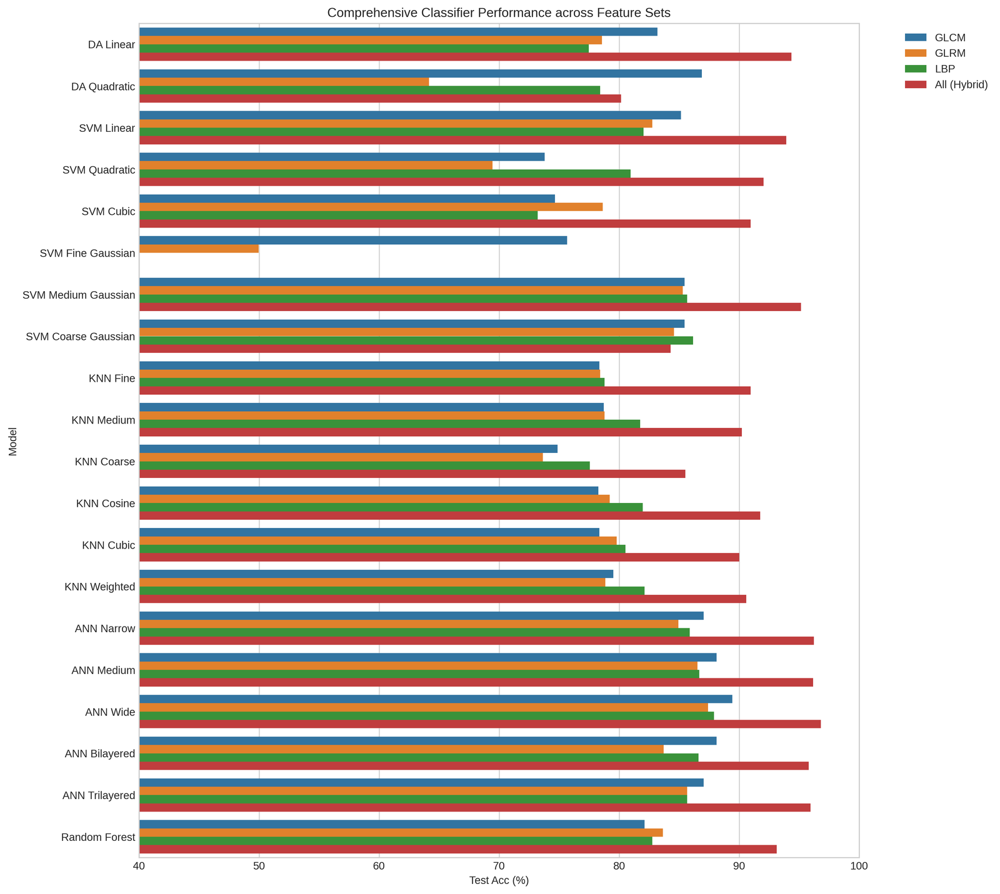
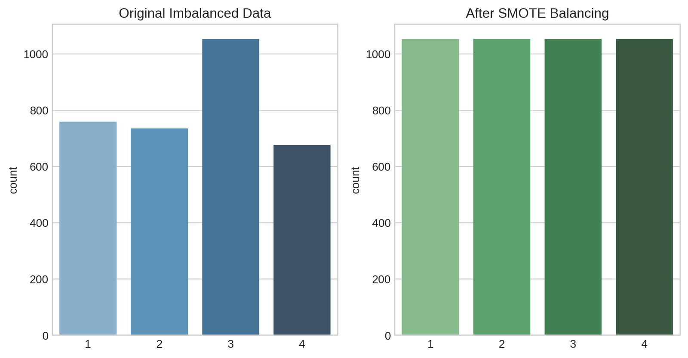

# CLOVES-4603: Benchmarking Classical Texture Features and Fine-Tuned Deep Models for Clove Quality Grading

**Accepted at the 7th Workshop on Vision for Agriculture (V4A / CV4A), CVPR 2026 (Denver, USA)**

[](https://saaillab.github.io/CLOVES-4603/)
[](https://saaillab.github.io/papers/cloves-4603/)
[](https://openreview.net/pdf?id=V1UbAtXS4M)
[](LICENSE)

**Authors:** Innocent Nyalala, Patrick Vincent Ndowo  
**Affiliation:** SAAIL Lab, School of Engineering and Science, Indian Institute of Technology Madras Zanzibar, Tanzania  



---

## Abstract

We introduce **CLOVES-4603**, the first public benchmark dataset for automated clove quality grading, comprising **4,603 standardized `224 x 224` RGB images** spanning four official commercial grades collected at the **Zanzibar State Trading Corporation (ZSTC)**. We benchmark classical GPU-free texture pipelines (`HOG + SVM`, `GLCM + GLRLM + LBP` texture fusion) against fine-tuned deep learning architectures (`ResNet-50`, `MobileNetV3-Large`) and frozen `DINOv2` vision transformers under **lot-aware 5-seed stratification**. Fine-tuned ResNet-50 reaches **99.67%** accuracy, whereas classical GPU-free texture-fusion SVM reaches **92.94%**, establishing explicit accuracy-compute-latency trade-offs for edge commodity inspection in East Africa.

---

## Key Contributions

1. **First Public Multi-Grade Zanzibar Clove Benchmark (`N = 4,603`):** Grounded directly in regulatory ZSTC commercial inspection criteria spanning **Grades 1 through 4** (`mpeta` / defect fractions governing over 53% farmgate price spreads).
2. **Lot-Aware 70/10/20 Stratification:** Prevents visual near-duplicate capture leakage across bulk inspection batches over five deterministic seeds.
3. **Five-Family Empirical Trade-off:** Bridges classical hand-crafted Haralick/LBP descriptors (`92.94%`, zero GPU required), frozen foundation probes (`DINOv2` `94.90%`), mobile CNNs (`MobileNetV3-Large` `99.35%`), and heavyweight backbones (`ResNet-50` `99.67%`).
4. **Statistical Rigor:** Reports 5-seed macro-F1 and bootstrap 95% confidence intervals across all model families (`n = 921` held-out test images).

---

## Benchmark Summary Table (`n = 921` Held-Out Test Images)

| Model Family | Feature / Backbone Architecture | Test Accuracy (%) | Deployment Profile |
|---|---|---:|---|
| Classical Shape Gradient | `HOG + SVM` | 32.68 | Fails to capture fine dried-calyx surface texture |
| Classical Texture Fusion | `GLCM + GLRLM + LBP + RBF-SVM` | **92.94** | Strong zero-GPU baseline for CPU embedded hardware |
| Frozen Self-Supervised | `DINOv2 ViT-B/14 (Linear Probe)` | **94.90** | Competitive label-free feature representation |
| Lightweight Fine-Tuned CNN | `MobileNetV3-Large` | **99.35** | Smartphone & offline Android/Flutter inference |
| Full Fine-Tuned CNN | `ResNet-50` | **99.67** | Highest benchmark accuracy across 4 commercial grades |



---

## ZSTC Official Commercial Clove Grade Specifications

| ZSTC Grade | Morphological & Color Description | Permitted Defect (*Mpeta*) | Split Distribution (70/10/20) |
|---|---|---|---|
| **Grade 1** | Bright golden / saffron brown buds, uniform bold heads | Maximum 3% defects | Stratified train / val / test |
| **Grade 2** | Slightly darker weathered brown, minor calyx unevenness | Maximum 7% defects | Stratified train / val / test |
| **Grade 3** | Duller greyish-brown pigmentation, mixed bud maturity | Maximum 20% defects | Stratified train / val / test |
| **Grade 4** | Heavily dark, stem-broken, shriveled or moldy *mpeta* cloves | Above 20% defects | Stratified train / val / test |

---

## Acquisition Protocol, Feature Extraction & Split Verification

1. **Controlled Warehouse Imaging & Lot Isolation:** All `4,603` square `224 x 224` RGB samples originate from certified inspection lots at the Saateni warehouse (ZSTC, Unguja, Zanzibar). Lot identifiers are locked strictly inside either the training (`70%`), validation (`10%`), or held-out test (`20%`, `n = 921`) partition so no repeated imaging session spans split boundaries.
2. **Classical Hand-Crafted Descriptor Bank:** Zero-GPU baselines fuse Gray-Level Co-occurrence Matrix (`GLCM`) Haralick statistics across multi-angle offsets, Gray-Level Run-Length Matrix (`GLRLM`) heterogeneity descriptors, and rotation-invariant Uniform Local Binary Patterns (`LBP`) before `StandardScaler` normalization and RBF-kernel SVM classification.
3. **Transfer Learning & Calibration Hygiene:** Deep vision backbones (`MobileNetV3-Large`, `ResNet-50`, and frozen `DINOv2 ViT-B/14`) undergo 5-seed reproducibility sweeps with paired macro-F1 evaluation and bootstrap `95%` confidence interval estimation on the identical `921`-image held-out partition.

---

## Limitations & Responsible Commodity Deployment Scope

- **Warehouse Illumination Sensitivity:** As demonstrated in companion SAAIL Lab confounding probes, standalone unmasked classifiers remain sensitive to inspection-tray surface texture and lighting shifts when buds are not foreground-segmented prior to grading.
- **Regional Botanical Scope:** Samples capture Unguja and Pemba commercial clove harvests graded under ZSTC standards and require local re-calibration before deployment on Malagasy, Indonesian, or Comorian export lots.
- **Advisory Decision Support:** `CLOVES-4603` benchmarks are released exclusively for quality-control research and cooperative inspector decision support, preserving fair farmgate pricing transparency across smallholder producers.

---

## Companion Publications & Benchmarks

- **Explanation Evidence Ratio (ETRI Journal 2026):** Proves segmentation-first compositional interpretability attains `100% EER` and `99.45% F1` on CLOVES-4603 (`DOI: 10.4218/etrij.2026-0225`) -> [Paper Page](https://saaillab.github.io/papers/clove-xai-etri2026/)
- **Participatory Co-Design (ACM AfriCHI 2025):** *"From Art to Algorithms: Co-Designing AI for Clove Grading with Zanzibar Indigenous Experts"* -> [Paper Page](https://saaillab.github.io/papers/clove-codesign-africhi2025/)
- **Capture-Session Confounding Audit (Under Review):** Proves background-swap override risks when grading buds without foreground segmentation -> [Paper Page](https://saaillab.github.io/papers/capture-session-confounding-cloves/)
- **Mobile Deployment (`Ubora-AI`):** Offline Flutter + TFLite INT8 inspection prototype -> [Project Website](https://saaillab.github.io/projects/ubora-ai/)

---

## Repository Contents

```text
CLOVES-4603/
├── README.md
├── LICENSE
├── CITATION.cff
├── session_confounding_probes/                # Causal session-confound validation suite
│   ├── session_tests.py
│   ├── confound_check.py
│   ├── clove_validation.py
│   └── mechanism_check.py
└── docs/
    ├── index.html                                 # Standalone CVPR 2026 project page
    └── assets/
        ├── Fig1_Class_Distribution.png            # Stratified 70/10/20 grade breakdown
        ├── Fig4_Comprehensive_Model_Comparison.png
        └── saail-crest.png
```

---

## Citation

```bibtex
@inproceedings{nyalala2026cloves4603,
  title={CLOVES-4603: Benchmarking Classical Texture Features and Fine-Tuned Deep Models for Clove Quality Grading},
  author={Nyalala, Innocent and Ndowo, Patrick Vincent},
  booktitle={Proceedings of the IEEE/CVF Conference on Computer Vision and Pattern Recognition (CVPR) Workshops -- Vision for Agriculture (CV4A)},
  address={Denver, USA},
  year={2026},
  url={https://openreview.net/pdf?id=V1UbAtXS4M}
}
```

---

## License, Attribution & Commercial Restriction

All code, benchmark documentation, splits, and research artifacts in this repository are licensed strictly under **Creative Commons Attribution-NonCommercial 4.0 International ([CC BY-NC 4.0](LICENSE))** by **Innocent Nyalala & SAAIL Lab (Indian Institute of Technology Madras Zanzibar)**.

- **Non-Commercial Scientific Use Only:** Materials may be studied, cited, and adapted strictly for non-commercial academic research and educational replication.
- **Mandatory Attribution:** Any use or derivative study must explicitly acknowledge **Innocent Nyalala** ([IITMZ Profile](https://www.iitmz.ac.in/schools/engineering-and-science/faculty/prof-innocent-nyalala)) and **[SAAIL Lab](https://saaillab.github.io/)** and cite the accompanying publication above.
- **Prohibition on Unauthorized Commercialization:** Commercial deployment, paid hosting, proprietary licensing, or product commercialization is strictly prohibited without prior written authorization and direct inclusion of **Innocent Nyalala (`innocent@iitmz.ac.in`)**.

Maintained by **[SAAIL Lab](https://saaillab.github.io/)** ([IITMZ Labs](https://www.iitmz.ac.in/labs)) · School of Engineering and Science, **[Indian Institute of Technology Madras Zanzibar](https://www.iitmz.ac.in/)** · PI: **[Innocent Nyalala](https://www.iitmz.ac.in/schools/engineering-and-science/faculty/prof-innocent-nyalala)**.
